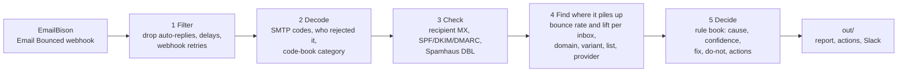

# Bounce Triage for EmailBison

*I built this for the AirOps Offsite team, as Part 2 of the hiring exercise: domain and inbox health.*

**Your bounce rate just jumped. Why, and what should you do?**

The usual answer is to re-verify the list. But an email can bounce for seven different reasons, and
re-verifying fixes only the first one:

1. The address doesn't exist (bad data).
2. Your domain isn't set up to prove the email really comes from you (authentication).
3. Your domain, or a link in your email, is on a spam blocklist (domain reputation).
4. Your copy looks like spam (content).
5. The recipient company's security filter blocks you (security gateway).
6. You sent too much, too fast (throttling).
7. One of your inboxes is broken (sender inbox).

Bounce Triage reads every bounce as it arrives and tells you which of these you have. For each one
you get the evidence in numbers, how sure it is (High, Medium or Low), the fix, what not to do, and
the steps to take in EmailBison. It posts all of this to Slack, and a person takes the steps.

> **For engineers:** Python 3.10+, standard library only, runs offline with no API keys. It listens
> to EmailBison's Email Bounced webhook and reads each bounce's delivery status report (RFC 3464).
> It decodes the SMTP and enhanced status codes (RFC 3463) with a code book that knows how Google,
> Microsoft and Yahoo word their errors, then applies 8 fixed rules (the 7 causes plus "noise").
> AI is optional and never decides a verdict.

## Why: a bounce doesn't always mean a bad list

When a client sends more and its bounce rate jumps, the obvious move is to re-verify the list. That
only removes addresses that don't exist. Most of the time the jump has several causes at once:

| What's going on | Fixed by re-verifying? | What fixes it |
|---|---|---|
| A list upload full of dead addresses | Yes | Re-verify that list, block the bounced addresses, pause uploads from it until a test batch is clean |
| A new domain missing DKIM or DMARC | No | Publish the missing DNS records, pause its inboxes until a test email passes |
| Inboxes sending too much, too fast | No | Lower their daily limits, ramp up by 10–15% a week, add inboxes instead |
| One copy variant flagged as spam | No | Pause that variant, send step 1 as plain text, rewrite it |
| A recipient's security filter (e.g. Mimecast) | No | Move those leads to their own campaign, send to them slowly from your best inboxes |

Re-verifying fixes the first row and costs money on the rest. When authentication is the problem,
for example, the addresses are fine: you'd pay to re-verify good leads and still bounce. Bounce
Triage tells you which rows you have and how much of the bounce rate each one causes.

## Quickstart: run it on the sample

You need Python 3.10 or newer. There's nothing to install, and you don't need any accounts or keys.

```bash
git clone https://github.com/TheBigLebowksi/emailbison-bounce-triage.git
cd emailbison-bounce-triage
python triage.py replay samples/
```

This runs Bounce Triage over a month of sample bounces for two made-up clients. It prints a short
summary for each client and writes the full results to `out/`. You get exactly the files that are
already in the repo, so `git status` shows no changes afterwards. That's how you know the run is
reproducible.

Don't use a terminal? Skip the commands and open [`out/report.md`](out/report.md) on GitHub. It's the
output of this exact run.

> **For engineers:** `python -m unittest` runs the test suite. It covers real-format bounce messages
> from Google, Microsoft and Yahoo, the noise filter, payload shapes, webhook dedupe, health bands and
> an end-to-end replay. Nothing leaves your machine unless you set one of the optional variables in
> [`.env.example`](.env.example) or pass `--dns live`. The only optional install is `dnspython`, for live DNS lookups.

## What you get

You get one Slack message per client. Here's the one for Kestrel, the sample client whose bounce rate
jumped (shaped like Atlas in Part 1, which went from 1.2% to 5.8%). It's trimmed to two of its five problems:

> 🔴 **Kestrel: 5.75% of emails bounced** (903 of 15,691 sent). Above the 5% danger line: fix the problems below before sending to new leads.<br>
> 5 separate problems are causing this. Fixing them could bring it down to about 0.7%.
>
> **1. Dead addresses in the list `apollo_oct_upload`**: 300 bounces, 1.9% of emails sent. Another 55 are spread out elsewhere<br>
> These mailboxes don't exist (5.1.1, 5.1.10, 5.4.1).<br>
> Not the inboxes or domains (spread over 12 inboxes on 3 domains). Not the email: a mailbox that doesn't exist bounces whatever it says.<br>
> → Re-verify that list before sending to it again, and treat catch-all results as unverified.<br>
> → Block the 322 addresses that don't exist so no campaign emails them again. Re-verify the 33 'Access denied' (5.4.1) ones first: they may be real people behind a company filter.<br>
> _Don't pause inboxes or rewrite the email: neither is the cause._
>
> **2. `kestrelreach-hq.com` fails email authentication**: 186 bounces, 1.2% of emails sent<br>
> Receivers reject its mail because DKIM and DMARC are missing (5.7.40, 5.7.515, 4.7.40).<br>
> Not the leads or the email (spread over 3 lists and 8 variants). Your other domains, `getkestrelreach.com` and `kestrelreach.co`, pass SPF, DKIM and DMARC and get none of these bounces.<br>
> → Add the missing DNS records.<br>
> → Take its inboxes out of campaigns until a test email passes SPF, DKIM and DMARC.<br>
> _Don't re-verify leads: the addresses are fine._
>
> _The full report has the evidence and 17 suggested EmailBison steps. Nothing has been changed in EmailBison._

Each problem says what's wrong, the SMTP codes behind it, what it ruled out, what to do, and what
not to do. "Ruled out" means the bounces spread evenly over that place instead of piling up on one
inbox, domain, email, list or provider. The count is the bounces on the named place only: the 55
dead addresses spread over the other lists are the normal background every list has, so fixing
`apollo_oct_upload` won't remove them. That's also why the estimate is 0.7%, not zero.

A healthy client gets a short message: 🟢 **Juniper: 1.12% of emails bounced** (61 of 5,432 sent).
Healthy (under 2%): keep sending. Juniper's message also names one inbox that bounces at 3x+ the
client's overall rate.

| To see | Open |
|---|---|
| The full diagnosis with all the evidence | [`out/report.md`](out/report.md) |
| The Slack messages | [`out/slack.md`](out/slack.md) |
| Every EmailBison step it suggests | [`out/actions.json`](out/actions.json) |
| Every bounce, kept or dropped, decoded | [`out/bounces_decoded.csv`](out/bounces_decoded.csv) |
| The rules: causes, thresholds, fixes, what not to do | [`rules.json`](rules.json) |
| The code book, with a source link for every code | [`codebook.json`](codebook.json) |

> **For engineers:** Slack only posts when `SLACK_WEBHOOK_URL` is set. When it runs as a webhook
> receiver (`serve`), it posts only when a verdict is new or its confidence changes. The suggested
> steps in `actions.json` use the operation names from EmailBison's API reference. API steps are marked `dry_run`; the rest are `manual`.

**What happens on its own.** The Slack alert goes out automatically as soon as a problem is found.
In `actions.json`, a step is marked to run on its own only when two things are true: the cause is
High confidence, and the step is safe and reversible. That means blocking addresses that don't exist
and adding tags. Addresses that bounced with Microsoft's ambiguous 5.4.1 "Access denied" are never
blocked on their own: they may be real people behind a company filter, so a person re-verifies them first. Steps that stop sending (taking inboxes out of campaigns, lowering daily limits,
pausing an email) always wait for a person, because a wrong call there costs a client its pipeline.
Nothing is sent to EmailBison yet: its API paths haven't been tested against a real account, so
every step is a dry run until they are.

## How it works: 5 steps

1. **Filter.** Throw out what isn't a real bounce: out-of-office replies, "still trying" delay
   notices, and the same webhook sent twice.
2. **Decode.** Read the error the receiving server sent back and look it up in a code book of 89
   known errors from Google, Microsoft, Yahoo and corporate security filters. The error says who
   rejected the email and why.
3. **Check.** Look up facts the bounce doesn't contain: the recipient's email provider, whether your
   domain has SPF, DKIM and DMARC, and whether your domain or your links are on the Spamhaus blocklist.
4. **Find where it piles up.** For each cause, see if the bounces cluster on one inbox, domain, copy
   variant, list upload or recipient provider. It looks in the place that cause usually shows up first
   (a list for dead addresses, a domain for authentication), then in the other four. That's how it can
   say "dead addresses piling up on one inbox" or "they also pile up at Yahoo", and what it ruled out.
5. **Decide.** Fixed rules turn all of this into a cause, a confidence level, the fix, what not to do,
   and the EmailBison steps.

**How sure is it?** Each verdict counts three signals: most of its bounces matched an exact code in
the code book (not a guess from keywords), the bounces cluster where that cause says they should,
and an outside check agrees (DNS, the blocklist, the verifier result or send volume). Three signals
means High, two Medium, one Low. Only High verdicts can have steps that run on their own. A problem found
somewhere its rule doesn't expect stays at Medium at most and gets a "check this first" step instead
of the usual fix. Places outside the usual one need stronger proof (20+ bounces, far too many to be
chance), because the more places you look, the more likely one looks bad by coincidence.

**Health band.** Each client also gets a color: green under 2% bounces, yellow from 2% to 5% (hold
new batches until the cause is clear), red above 5% (fix the problems before sending to new leads). If the client's
youngest sending domain is under 30 days old, green ends at 1.5% instead: a new domain has little
reputation to absorb bounces.

**Too small to call?** A cause with too few bounces goes on a watch list instead of getting a verdict.
An inbox bouncing at 3x the client's rate gets flagged even when no single cause is big enough.



> **For engineers:**
> - **Filter** (`ingest.py`): keeps `type/folder == Bounced`, drops auto-replies without
>   delivery-status evidence, and dedupes retries on `scheduled_email.id` *after* filtering, so a
>   delay notice can't hide the final bounce.
> - **Decode** (`decode.py`, `codebook.json`): prefers the RFC 3464 delivery-status part, then the
>   text body, then HTML. It handles Gmail, Exchange and Postfix formats, codes like `550-5.1.1` and
>   Yahoo tags like `[TSS04]`. It matches the most specific code-book entry, then keywords, then the
>   RFC 3463 class. Anything else goes to an `unknown` queue with its raw text. Greylisting is noise,
>   not throttling.
> - **Check** (`enrich.py`): MX for the recipient provider, SPF/DKIM/DMARC per sending domain,
>   Spamhaus DBL for sending and link domains. Mocked by default, live with `--dns live`.
> - **Find where it piles up** (`patterns.py`): lift = share of bounces ÷ share of sends. A segment is hot with ≥10
>   bounces, ≥200 sends and lift ≥1.5. Outside a cause's usual dimension a pile-up must also have
>   ≥20 bounces and sit ≥5 standard deviations above its fair share (`place_z`, a binomial z-score).
>   Second places and "ruled out" are measured within the hot segment's own sends, so the inboxes of
>   a failing domain don't look hot just because the domain is.
> - **Decide** (`diagnose.py`, `rules.json`): the code signal needs ≥60% of a cause's bounces to match
>   a specific entry. Under 30 days of `domain_age_days`, green ends at 1.5%. The decision thresholds
>   live in `rules.json`.
> - **Why the content cause isn't "blaming the copy":** it only counts bounces whose code is
>   content-specific (Gmail 5.7.1 "likely unsolicited", Gmail 4.7.0 "nature of the content", Gmail
>   4.7.28 when it names a URL domain, Yahoo PH01/TS07, gateway content policies). Those bounces must also concentrate on one variant across
>   several domains and providers, and address bounces (5.1.x) on that variant are excluded.

## Repo layout

```
triage.py               CLI: replay | serve
bounce_triage/          models, config, ingest, decode, enrich, patterns, diagnose, actions, report, llm, pipeline,
                        server
codebook.json           89 SMTP code/text patterns -> category, fault side, source
rules.json              thresholds, health bands + the 8 causes
samples/                generated inputs and mocks (bounces.jsonl, sends.csv, senders.csv, campaigns.json, *_mock.json)
tests/                  53 tests: real-format NDR fixtures, the Slack wording, code-book fixes, filter, payload shapes, dedupe,
                        DBL errors, health bands, outliers, unexpected places, webhook server, end-to-end replay
bench/                  accuracy benchmark: generated clients with planted causes (ACCURACY.md has the results)
out/                    committed outputs of the sample run
```

## Connect it to a real EmailBison workspace

1. Choose a secret token and set it as `WEBHOOK_TOKEN`. Set `SLACK_WEBHOOK_URL` to your Slack
   channel's incoming webhook.
2. Start the server so other machines can reach it: `python triage.py serve --host 0.0.0.0 --port 8080`.
   It speaks plain HTTP, so put HTTPS in front of it (a reverse proxy, or a tunnel like Cloudflare
   Tunnel or ngrok). The token travels in the URL and shouldn't go over plain HTTP.
3. In each EmailBison workspace, go to **Settings → Webhooks**, add a webhook for the **Email
   Bounced** event, and point it at `https://<your-host>/webhook?token=<your token>`.
4. Click **Send test webhook**. The server answers 200. A test event with no lead and no bounce text
   is dropped as `empty_event`, so it doesn't change any rate. Then open
   `https://<your-host>/report?token=<your token>` to see the report.

From then on, every bounce updates the report, and Slack gets a message when a verdict is new or its
confidence changes. Every event says which workspace it came from, so one server handles all your
clients. Bounce Triage doesn't change anything in EmailBison yet. It tells you in Slack what to do,
and a person does it.

**One gap to know about:** a bounce rate needs the number of emails sent, and the bounce webhook
doesn't include it. For now the prototype reads send counts from `sends.csv` in the `--inputs` folder.
Pulling them from EmailBison's stats is first on the next-steps list.

> **For engineers:** each POST is appended to `state/events.jsonl`, the pipeline reruns and `out/` is
> rewritten. Valid JSON always gets a 200, duplicates included, so EmailBison stops retrying; a body
> that isn't JSON gets a 400. `/report` needs the same token, and the server log masks it. The parser
> accepts snake_case, camelCase, nested and flat payloads. `--dns live` does real DNS and Spamhaus
> lookups and falls back to the mocks.

## Assumptions: what's real, what's mocked, what isn't checked yet

This is a prototype. Here's what is real and what is a stand-in.

**Real**
- The sample bounces use the actual formats Google, Microsoft, Yahoo, Mimecast and Proofpoint send.
  Every code in the code book points to the page it came from.
- The webhook payload follows the shape in EmailBison's official API reference.

**Mocked**
- Send counts, inbox stats (daily limits, volume, domain age) and campaign copy come from files in
  `samples/`.
- DNS and Spamhaus lookups are mocked by default. The report labels every value `mock` or `live`.
  A domain the mock files don't know shows as "not checked", never as failing.
- The verifier result and the date each lead was last verified (custom fields on the lead). A lead
  with no verifier result doesn't count as evidence either way.

**Not checked yet**
- No real EmailBison webhook has been captured. The first step with a real workspace is to send a
  test webhook and replay it.
- DKIM is checked on common selector names, not the one each domain actually uses.
- Google Postmaster Tools and Microsoft SNDS aren't used.

**What bounces can't tell you**
- Mail that lands in spam or quarantine doesn't bounce, so a low bounce rate can hide a placement
  problem.
- A sequencer's bounce rate isn't always right: it can count auto-replies, delay notices or its own
  DNS and connection failures as bounces. Bounce Triage counts only real bounces, so its rate can
  differ from EmailBison's. EmailBison's "Email Send Failed" event isn't a bounce, and the tool
  ignores it.

> **For engineers:** through public resolvers, Spamhaus's free mirror answers `127.255.255.254`.
> That's an error, not a listing, and the tool treats it as one. Commercial use needs a paid DQS key.
> Production should read the DKIM selector from the `s=` tag of a sent message. Role-address share is
> measured on bounced leads only, because `sends.csv` has no rows per lead.

## What's next

1. **Real send totals** from EmailBison's stats instead of `sends.csv`.
2. **Test on a real workspace:** capture a test webhook, replay it, and fix the parser if needed.
3. **Let it act.** Connect the safe steps (blocking dead addresses, tags) to EmailBison's API once
   its paths are tested on a real account. Once a few weeks of Slack verdicts show a person agreeing
   with the High-confidence ones, consider the bigger steps too, with a cap per client per day and a
   log of every step taken so none runs twice.
4. **Process each webhook on its own.** Today every webhook reruns the pipeline over all stored
   events, which is fine for a prototype but grows with the log, and with `--dns live` it redoes
   every lookup. Production should update the counts per event and cache DNS answers.
5. **Google Postmaster Tools** as an outside check for authentication and spam verdicts.
6. **Seed tests** to catch spam-folder and quarantine problems that bounces can't show.
7. **Link verdicts to reply-rate drops.** A client can lose replies while bounces stay flat.

## How AI is used, and where it isn't

**AI never decides a verdict.** Fixed rules do, so the same bounces always give the same answer, and
every claim traces back to a number you can check.

AI does two small jobs, and only if you add an Anthropic API key:
- **Unknown bounces:** it suggests a cause for errors the code book doesn't know yet. The suggestion
  shows up in the report but doesn't count toward any verdict. A person decides whether to add it to
  the code book.
- **The summary:** it writes the plain-English summary from the verdict's facts. Without a key, or if
  the AI fails, a fixed template writes it instead.

**How I built it with AI:** I used Claude Code. It wrote most of the code, pulled the official
error-code pages from Google, Microsoft and Yahoo into the code book, read EmailBison's API reference
to match the webhook shape, and searched for existing tools before I built anything. I designed and
reviewed the causes, the rules and the confidence model myself.

> **For engineers:** [`bounce_triage/llm.py`](bounce_triage/llm.py) calls `claude-sonnet-5-5` with
> JSON-schema-constrained output for the unknown-bounce suggestions. It's off unless
> `ANTHROPIC_API_KEY` is set.

## Credits

Error codes come from Google, Microsoft and Yahoo's official error-code pages, Mimecast and Proofpoint
docs, and RFC 3463 and RFC 3464. Every code in [`codebook.json`](codebook.json) names its source.

Two open-source skills written against EmailBison's live API shaped the field names and the starting
idea: Pipeline Playbooks' [Deliverability Triage](https://www.pipelineplaybooks.com/skills/deliverability-triage)
(MIT), which makes the same point that re-verifying the list fixes only one of several causes, and
[growth-today blacklist-bounce-audit](https://www.skillsdirectory.com/skills/growth-today-blacklist-bounce-audit).
Both are instructions for an AI agent to follow. Bounce Triage turns the idea into a program: it uses sends
as the denominator, checks five places with controls, applies fixed rules, and writes the EmailBison
steps.

MIT licensed, see [LICENSE](LICENSE).
